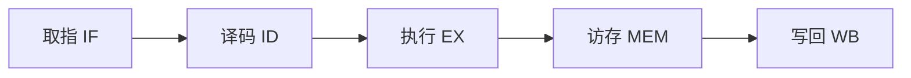

# 数据通路与流水线

## 单周期数据通路

单周期 CPU 在一个时钟周期内完成一条指令的取指、译码、执行、访存、写回。其时钟周期由最慢的指令（通常是 `lw`）决定：

$$
T_{\text{clk}} \ge t_{\text{IF}} + t_{\text{ID}} + t_{\text{EX}} + t_{\text{MEM}} + t_{\text{WB}}
$$

## 五级流水线

经典 RISC 五级流水线将指令执行拆分为 5 个阶段：

| 阶段 | 缩写 | 功能 |
| ---- | ---- | ---- |
| 取指 | IF   | 从指令存储器读取指令 |
| 译码 | ID   | 解码并读寄存器 |
| 执行 | EX   | ALU 运算 / 地址计算 |
| 访存 | MEM  | 访问数据存储器 |
| 写回 | WB   | 结果写回寄存器 |

理想情况下，$n$ 条指令在 $k$ 级流水线上的执行周期数为：

$$
\text{Cycles} = n + (k - 1)
$$

当 $n \to \infty$ 时，加速比趋近于流水线级数 $k$。



## 流水线冒险

!!! danger "数据冒险（Data Hazard）"
    后一条指令需要用到前一条指令尚未写回的结果。可通过**转发（forwarding）**或**插入气泡（stall）**解决。

下面是一个存在数据冒险的例子：

```asm
add x1, x2, x3    # x1 在 WB 阶段才写回
sub x4, x1, x5    # 紧接着就要用 x1 —— 需要转发
```

!!! tip "解决思路"
    - **转发**：把 EX/MEM 阶段的结果直接送回 ALU 输入
    - **停顿**：无法转发时（如 load-use）插入一个气泡周期
