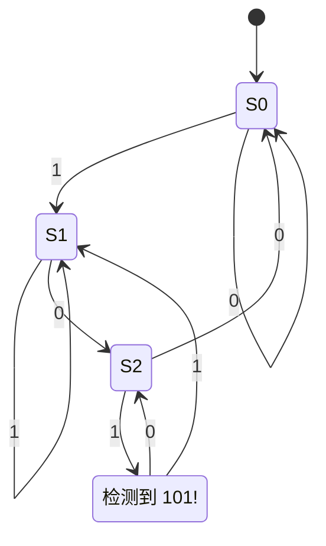

# 时序逻辑与状态机

时序逻辑电路的输出取决于**当前输入**和**内部状态**，核心是存储元件——触发器。

## D 触发器

D 触发器在时钟上升沿把输入 $D$ 锁存到输出 $Q$：

$$
Q_{n+1} = D
$$

```verilog
module d_flip_flop(
    input  wire clk,
    input  wire rst_n,   // 低电平复位
    input  wire d,
    output reg  q
);
    always @(posedge clk or negedge rst_n) begin
        if (!rst_n)
            q <= 1'b0;
        else
            q <= d;
    end
endmodule
```

## 有限状态机（FSM）

有限状态机由**状态集合** $S$、**输入** $\Sigma$、**转移函数** $\delta: S \times \Sigma \to S$ 构成。

以一个「检测输入序列 `101`」的 Moore 型状态机为例：



## 三段式写法

!!! note "推荐的 FSM 编码风格"
    工业界常用「三段式」写法：一段管状态寄存器、一段管次态逻辑、一段管输出逻辑，可读性最好。

```verilog
// 第一段：状态寄存器
always @(posedge clk or negedge rst_n)
    if (!rst_n) state <= S0;
    else        state <= next_state;

// 第二段：次态组合逻辑
always @(*) begin
    case (state)
        S0: next_state = in ? S1 : S0;
        S1: next_state = in ? S1 : S2;
        // ...
        default: next_state = S0;
    endcase
end
```

!!! warning "避免锁存器"
    组合逻辑 `always @(*)` 块中，务必给每个分支都赋值（或写 `default`），否则会综合出意外的锁存器。
